# HireSense - User Manual
Team 11, SKYAK

10/11/26

**Version:** 1.0

## 1. Introduction
HireSense crawls the web and gathers intern and entry-level tech jobs in the DFW area to help young jobseekers.
It is useful because it includes other helpful features such as market analysis, AI interviews, and application autofill.
Additionally, it is always adding newly posted jobs to the database and removing expired ones.
## 2. System Requirements
- **Hardware:** Recommended to use a computer or laptop: Windows 11/macOS v27
- **Software:** Any web browser/application, AI interview and autofill only supported in Chrome

## 3. Installation Guide
No installation required

Link: https://hiresense-9yub.onrender.com/

## 4. Getting started
1. Click on the link to open the website.
2. Sign up with a username, email, and password (follow the steps in 'Feature 1').
3. Upload your resume (follow the steps in 'Feature 4').

## 5. Features and Functions
### Feature 1: Account sign-up and login
Creates an account and keeps the job board, resume, and profile behind login.
1. Open HireSense
2. Choose Sign Up

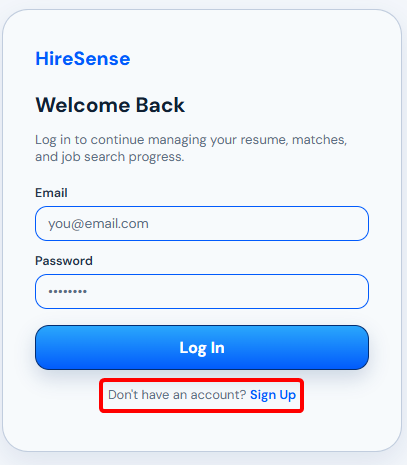

3. Enter a username, email, and password into the three fields
4. Click Create Account

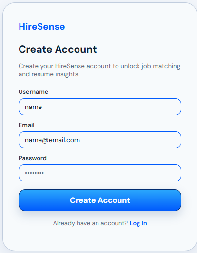

5. On later visits, enter the same email and password and click Log In
6. Open the account menu and choose Log out to end the session

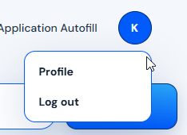

### Feature 2: Live job search
Shows active jobs collected and supports search, filters, sorting, and paging.
Each listing links to the real application page.
1. Log in and stay on the home page
2. Type in the top field to search by title, company, or skill

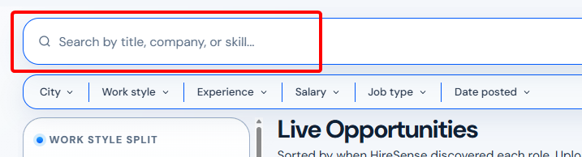

3. Click on the dropdowns below the search field to filter by city, work style, experience, salary, job type, or date posted

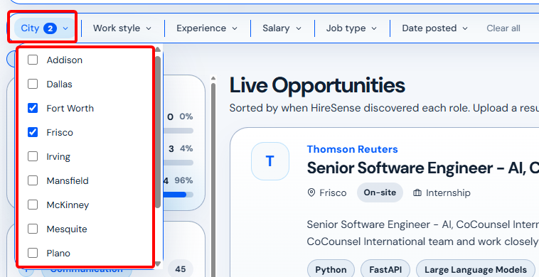

4. Sort by best match, newest posted, recently discovered, company, or location

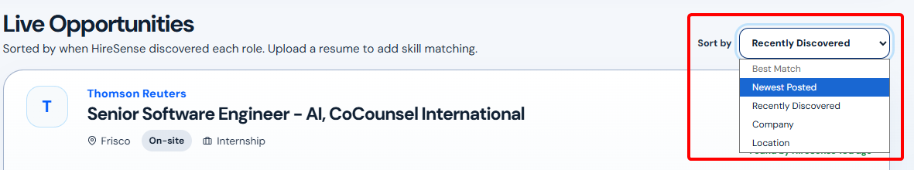

5. Click a job card to open its details
6. Click Apply directly to open the employer’s application page

### Feature 3: Market insights
Summarizes the current job feed on the home page.
1. Open the home page
2. Read the sidebar next to the job list
3. Use the skill and location counts to see what the current listings ask for

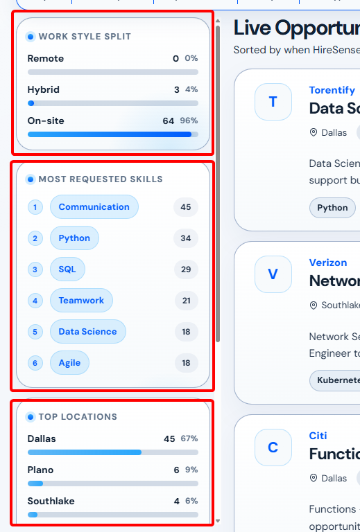

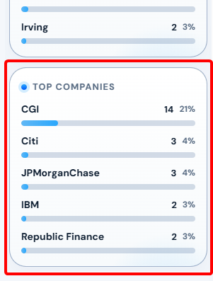

### Feature 4: Resume upload and analysis
Accepts a PDF or DOCX resume up to 5 MB.
Extracts contact details, skills, education, experience, and projects.
Scores the resume and lists strengths, warnings, and priority fixes.
1. Click Upload Resume

2. Drop a PDF or DOCX file, or click Choose File
3. Wait for Processed
4. Review the score, skills, sections, warnings, and priority fixes

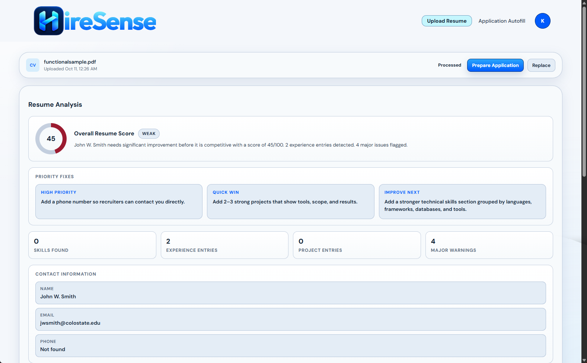

5. Click Replace to upload a different file

### Feature 5: Job match score
Compares the saved resume with a job’s listed skills.
Shows a match percentage, matched skills, and missing skills.
1. Upload a resume first
2. Open a job from the home page
3. Read Your Match Score
4. Compare Matched Skills with Missing Skills

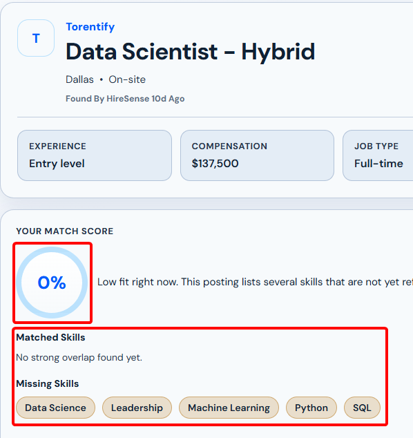

5. On the home page, sort by Best match to rank listings against that resume

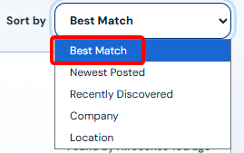

### Feature 6: AI interview prep
Runs a short practice interview for the open job.
Scores each answer and shows a final result.
Supports typed answers and voice input in Chrome.
1. Upload a resume
2. Open a job
3. In AI Interview Prep, click Start Interview

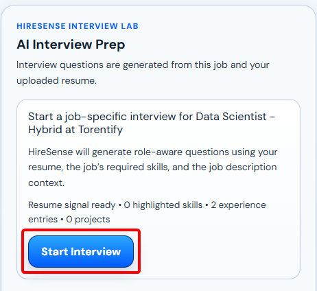

4. Type an answer, or use the microphone
5. Click Submit Answer
6. Read the score and feedback

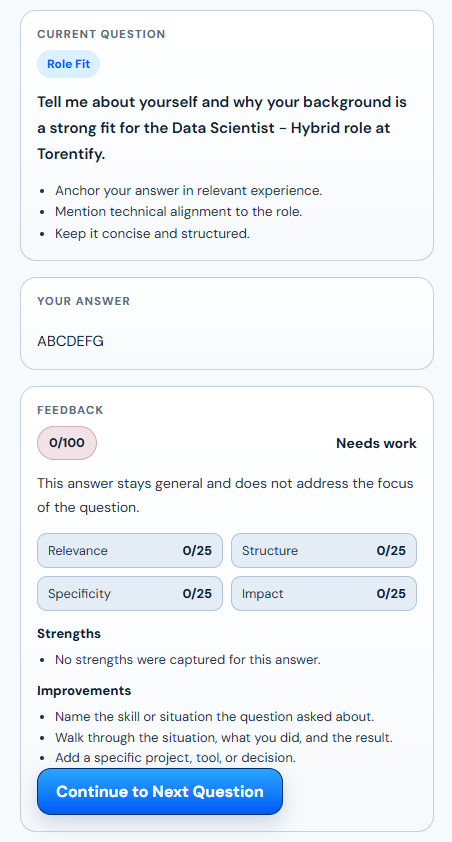

7. Click Continue to Next Question
8. Click Start New Interview or Restart to begin again

### Feature 7: Application autofill
Builds an applicant profile from the resume.
Sends only the details the user confirms to the Chrome extension.
Fills supported fields on an application page and leaves blanks empty.
1. Upload a resume
2. Click Application Autofill or Prepare Application

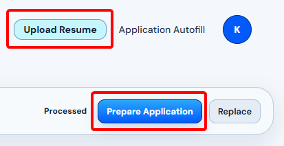

3. Review and edit the extracted details

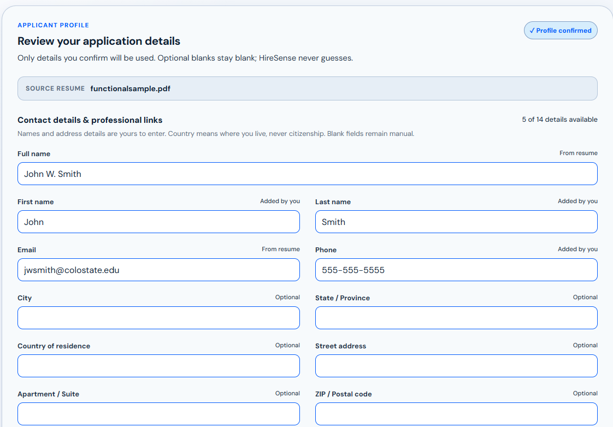

4. Click Confirm my information
5. Click blue link to install extension
6. Click Send to extension

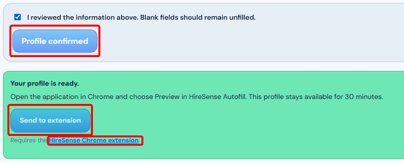

7. Open the employer’s application page in Chrome
8. Open HireSense Autofill and choose Preview
9. Review the fields, then fill only the supported ones

## 6. Troubleshooting
| PROBLEM | CAUSE | SOLUTION |
|----------|----------|----------|
| Resume upload is rejected  | The file is not a PDF or DOCX, is empty, is over 5 MB, or has no extractable text  | Upload a PDF or DOCX under 5 MB that contains selectable text  |
| When using search and filters, no jobs are found  | Too many filters are being used  | Deselect filters until jobs begin to show up again  |
| Can not download the extension  | The application autofill feature is only available on Chrome, as the extension is only available on the Chrome extension store | Fill fields manually, or switch to a Chromium browser  |
		
## 7. Contact Information
- **Support Email:** saadsyed@my.unt.edu
- **Project Repository:** https://github.com/hiresenseSKYAK/HireSense

## 8. FAQ
**Q:** Where do the jobs come from?

**A:** LinkedIn, Handshake, and direct company boards.

**Q:** How often does the feed update?

**A:** A scheduled crawler runs every six hours. It adds new listings, updates existing ones, and removes postings that are confirmed closed.

**Q:** Does HireSense submit the application?

**A:** No. Autofill fills supported fields only. It does not click Submit, Next, or move to the next page.
